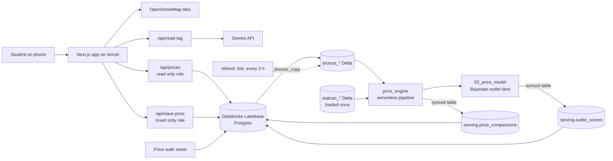

# Campus Price Map

**Find the cheapest coffee, Red Bull or sandwich near you at UBC.**

Built in 24 hours at [HackCamp 2026](https://hackcamp-2026.devpost.com/) (nwPlus, UBC Vancouver) by a team of two.

| | |
|---|---|
| Live app | [campus-price-map.vercel.app](https://campus-price-map.vercel.app) |
| Demo video | _add link_ |
| Figma | _add link_ |
| Devpost | _add link_ |

> **📋 Master plan:** [`docs/SPEC.md`](docs/SPEC.md) is the build spec we work from: product, data, the Databricks
> price engine, design, guardrails, build order for both tracks, and the prizes we're going for.

> **🧪 FIRST PROTOTYPE available:** [`first-prototype/`](first-prototype/) is a working first prototype (v0.1.0) of
> the full loop (scan → share price → cheapest first → "Did you buy it?" → community confirmation, sold out, map,
> outlet pages, thank-yous). It is a Databricks App (AppKit + React) on Lakebase with **sample data**, built as a
> reference and demo for the main build. See [`first-prototype/README.md`](first-prototype/README.md) to run it.

---

## The problem

UBC students who buy the same coffee or energy drink most days can't tell which outlet sells it cheapest, so they overpay without knowing by how much.

The same item can cost noticeably more at one outlet than at another a few minutes away: the Nest, Mercante, Harvest Market, the International Food Village, University Village, Wesbrook Village and more. Campus Nutrition has done great work here, including a 2023 comparison of grocery prices at five stores around UBC. What we haven't found is a way to see what an everyday café item, like a medium drip coffee or a Red Bull, costs at each campus food outlet right now. So students go to whatever is closest or most familiar.

On a single purchase the gap is small. For something you buy most school days, it can add up over a term, and that matters for students already on a tight budget.

## What we're building

A mobile web app with a campus map that shows the price of 21 everyday items at the outlets we track. Search an item and see where it's cheapest **near you**, closest outlets first. Prices come from students: snap a photo of a price tag, Gemini reads it, you confirm, and it lands on the map.

> **Find where the exact coffee or energy drink you buy every day is cheapest near you, right now, from prices students share.**

We don't ask anyone to make a long trip. Results start with outlets a short walk away, and farther ones only stand out when the saving is worth it.

## Who it's for

- **The daily buyer** (who we design for first): buys coffee or an energy drink most days, so savings actually compound.
- **The in store decider:** holding a Red Bull at the counter, wondering if it's cheaper next door.
- **The new student:** first years, exchange and international students still learning campus.
- **The between classes student:** fifteen minutes, hungry, wants a quick and fair answer.

## How it works

### Built for HackCamp

1. **Map home.** Every outlet is a pin on a UBC map. Pins show price level with colour *and* a `$`, `$$` or `$$$` label, so colour is never the only signal. Search bar asks "What do you want?" and a list view shows everything without the map.
2. **Search results.** Every tracked outlet selling the item, measured from where you are or a spot you pick on the map. Close outlets come first, cheapest first, then farther ones. Each row shows price, approximate distance (straight line, not a walking route), source and when it was last updated. A line at the top frames the choice ("80 cents less at Harvest Market, about 150 m away") and shows the math for a term: "80 cents × 4 a week × 12 weeks ≈ $38, if prices hold and you switch every time."
3. **Snap a price tag.** Take a photo, Gemini reads item, size and price, the app matches it to our item list, you confirm or fix it, and it saves. The new price shows up on the map right away.
4. **Outlet page.** Hours and every tracked item it sells, each with its own comparison ("Cheapest on campus", "40 cents above campus average"). There's no single cheap or expensive score for a whole outlet, because a place can have the cheapest coffee and the priciest Red Bull.
5. **"vs BC average" badge.** Where a campus item truly matches Statistics Canada's provincial price data, a small badge compares the two, clearly labelled as a BC average.
6. **Sold out button.** Saves the next student a wasted trip.
7. **Directions in Google Maps.** Tap "Directions" on any outlet and the app opens Google Maps with walking directions to it. That hand-off is the only routing the app does: it doesn't draw routes or give turn-by-turn directions itself. Distances in the app stay approximate.

### Where it's going

- **Scanner first home screen:** open the app in a store, scan the barcode, and it knows the item and the outlet.
- **"Did you buy it?"** after checkout, to capture the price actually paid.
- **Community verification:** new prices and sold out reports stay pending until other students confirm them. Receipts and matching reports move faster; big jumps need more confirmations.
- **Thank yous** that show contributors how many students they helped.
- More items and outlets, nearby grocery stores, student reported deals, and alerts when your usual item is cheaper nearby.

## The items we track

21 items in 9 categories, chosen because they're sold at several outlets, come in fixed sizes so prices compare fairly, and are things students buy daily. A sample:

- **Energy drinks:** Red Bull 250 ml, Monster 473 ml, Celsius 355 ml
- **Soft drinks and water:** Coca‑Cola can and bottle, bottled water 500 ml, sparkling water
- **Coffee and tea:** drip coffee small and medium, latte, iced coffee, tea
- **Grab and go:** bagel with cream cheese, muffin, premade sandwich, wrap, sushi pack
- **Snacks:** protein bar, chips, banana or apple

Different sizes are compared per 100 ml.

## Architecture

The browser only ever talks to our Vercel API routes. It never connects to the database or to Gemini directly.



**Find the cheapest spot:** search calls `/api/prices`, which reads Lakebase with the `app_reader` role and returns outlets sorted closest first, then cheapest. When the Databricks results in `serving.price_comparisons` are under 3 hours old, the app serves them, with per item chips ("40 cents above campus average"), the nearest cheaper outlet, Worth the walk and the "vs BC average" badge. Otherwise it falls back to the live `current_prices` view and campus medians, so the app never depends on a job having run.

**Log a price:** the photo goes to `/api/read-tag`, which sends it to Gemini with the key from Vercel environment variables. Gemini returns item, size and price as JSON, the route matches it to our item list, and the student confirms. `/api/save-price` validates it and inserts with the `app_writer` role.

**Data engine:** one Databricks Job, `refresh`, runs every 2 hours on serverless (defined in [`databricks/databricks.yml`](databricks/databricks.yml) as a Declarative Automation Bundle):

1. `02_bronze_copy` copies the app tables from Lakebase into `workspace.cpm.bronze_*` Delta tables in one consistent snapshot, and fails if any row count differs.
2. `price_engine`, a Lakeflow Declarative Pipeline, cleans reports, applies the pending/official rules, computes walk distances, and builds `gold_price_comparisons` (the table the app serves) plus a parity check against the live Postgres view.
3. `03_price_model` fits the price model (see [Price analysis](#price-analysis)) and writes outlet tiers and price estimates.
4. Two synced tables push `price_comparisons` and `outlet_scores` back into Lakebase's `serving` schema, and `04_grants` re-grants `app_reader` read access.

A full run takes about 30 minutes, mostly serverless start-up, and emails us if it fails. The StatCan tables are loaded once by `01_statcan` (StatCan publishes monthly). A Genie space, "Campus Price Map", answers plain-English questions over the same Delta tables.

## Tech stack

| Layer | Tool |
|---|---|
| App | Next.js (App Router, TypeScript) and React, written with Claude Code |
| Map | Leaflet + OpenStreetMap |
| Walking directions | Hand-off to Google Maps (a link that opens it); no routing in the app |
| Hosting and secrets | Vercel (every push to `main` deploys) |
| App database | Databricks Lakebase (managed Postgres) |
| Analytics | Databricks Lakeflow Jobs and Declarative Pipelines on serverless, Delta tables in Unity Catalog, synced tables, Genie, Declarative Automation Bundles |
| Price tag reading | Gemini API |
| Public data | Statistics Canada via the `stats_can` Python library |
| Design | Figma |

## Data

### Lakebase (app database)

| Table | What's in it | Source |
|---|---|---|
| `locations` | Outlet name, area, operator, hours, lat, lng | UBC Food Services and AMS pages; coordinates from OpenStreetMap |
| `items` | 23 tracked items, size, category | Chosen by the team |
| `prices` | Price per item per outlet, time, `source` (walk, menu, seed, photo, typed...) | Our price walk, online menus, then students |
| `price_votes` | Students confirming or disputing a price | Students |
| `stock_reports` | Sold out reports | Students |
| `serving.price_comparisons` | Every official price with its campus comparison, nearest cheaper outlet, Worth the walk, model estimate and StatCan match | Synced from Databricks |
| `serving.outlet_scores` | Each outlet's `$` / `$$` / `$$$` tier from the price model, measured or estimated | Synced from Databricks |

### Statistics Canada tables

| Table | What it is | How we use it |
|---|---|---|
| 18‑10‑0245‑01 | Monthly average retail prices | The "vs BC average" badge |
| 11‑10‑0125‑01 | Detailed food spending | Pitch context |
| 11‑10‑0223‑01 | Household spending by income quintile | Who feels food costs most |
| 21‑10‑0019‑01 | Food services and drinking places sales | Spending trend |
| 13‑10‑0835‑01 | Food insecurity by demographic | Why affordability matters |

StatCan is supporting context, not the headline. We only compare true per unit matches, and we label every figure as a provincial average that lags a couple of months.

## Price analysis

A plain average is misleading here. Outlets stock different things, so a café that mostly sells lattes looks expensive next to a store that mostly sells water, even if it charges less for the same items. So [`03_price_model`](databricks/src/03_price_model.py) compares outlets on the **same items** with a Bayesian hierarchical model of log price:

```
log price(item, outlet) = item + outlet type + operator + outlet + outlet × category + error
```

- The **item** term absorbs that a sandwich costs more than a banana.
- The **outlet** term is what's left: how much more or less an outlet charges for the same thing. Because prices are in logs, `exp(b) - 1` reads as a percentage against the campus average.
- **Partial pooling:** an outlet with few prices is pulled toward outlets of the same type (café, convenience...) and operator (UBC Food Services, AMS, chain...), and its uncertainty says so. The **outlet × category** term lets a place be cheap for coffee and pricey for snacks.
- Gaussian priors make the posterior closed form, so it runs in NumPy in seconds with no sampling. With enough prices, the prior widths are fitted by empirical Bayes instead of fixed.

### What the model is used for

| Output | Where it goes |
|---|---|
| Outlet tier: `$`, `$$` or `$$$` (cheaper, within 5%, or pricier than campus average) | Synced as `serving.outlet_scores` and shown on the map. "Measured" when the outlet has enough of its own prices, "estimated" when it leans on similar outlets, and "?" when the model isn't confident. |
| Estimated price for items an outlet carries but nobody has priced yet, with an 80% interval | Fed back into the next pipeline run and shown as an estimate, never as a real price. |
| Model metrics | `gold_model_metrics`: method, fitted priors, leave-one-out error and interval coverage. |

### Keeping it honest

- **It has to beat the obvious baseline.** Each run predicts every known price from all the others (leave-one-out). If the model doesn't beat each item's campus median, only measured tiers are published and no estimates are. On today's data it does: error 0.21 against 0.30.
- **Calibrated intervals.** Estimate intervals are rescaled so that 80% intervals really contain about 80% of held-out prices.
- **Descriptive, not causal.** We say an outlet charges more for the same item, never why. It's a snapshot from a small sample.
- **StatCan stays separate.** Only a few items match, in different units, so the BC comparison is a per unit ratio outside the model, labelled as a provincial average that lags a couple of months.
- **The app survives without it.** If the results are missing, unreadable or over 3 hours old, the app quietly uses live prices and medians instead.

## Guardrails

- **Gemini only suggests.** Nothing saves until a student confirms it, and reads are matched to our item list.
- **Sanity checks on the server.** Prices under $0.25 or over $25 are rejected; anything far above the item's usual price is flagged.
- **Least privilege database roles.** `app_reader` can only select; `app_writer` can only insert into `prices` and `stock_reports`. No edits or deletes from the app.
- **Secrets stay server side.** The Gemini key and database passwords live only in Vercel environment variables and `.env.local`, which is never committed.
- **Rate and size limits.** Photos under 5 MB, about 10 reports per device per minute.
- **Honest labels.** Every price shows its source and when it was updated; stale prices are dimmed.
- **Light on personal data.** No accounts or names. Tag photos are sent to the Gemini API to read the price and aren't stored by the app. Your location is only used for the search, never saved.
- **Accessible by default.** `$` labels alongside colour, strong contrast, big tap targets, and a full list view as an alternative to the map.

## Running it locally

```bash
git clone <this repo>
cd campus-price-map
npm install
cp .env.example .env.local   # then fill in the values below
npm run dev
```

Environment variables (see `.env.example`):

```
GEMINI_API_KEY=            # from Google AI Studio
DATABASE_URL_READER=       # Postgres connection string for app_reader, SSL on
DATABASE_URL_WRITER=       # Postgres connection string for app_writer, SSL on
PRICE_SOURCE=pipeline      # pipeline: use Databricks results when fresh; live: Postgres views only
```

The Databricks side deploys from `databricks/` with the Databricks CLI:

```bash
cd databricks
databricks bundle validate --profile <your-profile>
databricks bundle deploy -t dev --profile <your-profile>
```

## Repo layout

- `docs/SPEC.md` **master plan**: the build spec both of us (and our Claude Code sessions) work from
- `data/` seed prices from the campus price walk, the item and outlet lists, and StatCan extracts
- `databricks/` the Databricks bundle: the `refresh` Job, the `price_engine` pipeline, the price model, StatCan loading, and local checks
- `prompts/` Claude Code and Gemini prompts
- `first-prototype/` **FIRST PROTOTYPE** (v0.1.0): working Databricks App on Lakebase with sample data

## What we know so far

We're keeping ourselves honest about what's evidence and what's still a guess.

| Claim | Status |
|---|---|
| The same item costs different amounts at different outlets | Evidence from online menus and early interviews; confirming on the price walk |
| We've both overpaid at one outlet and found it cheaper at another | Our own experience |
| Students bring up price without being asked | Still testing: interviewing with a script that never mentions price |
| Students would walk about 10 minutes to save $2 | Our guess, testing in every interview |
| Campus Nutrition compared grocery prices at five stores near UBC (2023), not café items at campus outlets | Confirmed via UBC Wellbeing; still checking what the current site shows |

## Prize tracks we're entering

- **Superlatives:** Best Problem‑Solution Fit and Most Accessible Design (beginner stream), with Community Impact as a backup
- **Best Use of Databricks:** Lakebase as the app database, a Lakeflow pipeline and Bayesian price model on serverless, synced tables back into Lakebase, a scheduled Job, StatCan benchmarks, and a Genie space, all deployed as one bundle
- **Best Use of Gemini API (MLH):** reading price tag photos
- **GoDaddy Registry domain (MLH)**, plus Entire and Auth0 if time allows

## Credits

- Map data © OpenStreetMap contributors
- Contains information licensed under the Open Government Licence – Canada (Statistics Canada)
- Prices reported by UBC students
- Product data from Open Food Facts, available under the Open Database License (ODbL). See `data/barcodes.LICENSE.md`

Built from a fresh repository during HackCamp 2026 (hacking began 12:00 PM, November 7), with the app written using Claude Code.

## Team

Sergio Lopez and Sebastian Salomon Wong, UBC Vancouver.

- **Product and Data:** research, interviews, Figma, Databricks and StatCan, Devpost and pitch
- **Builder:** the app with Claude Code, the map, Gemini photo logging, GitHub and Vercel
